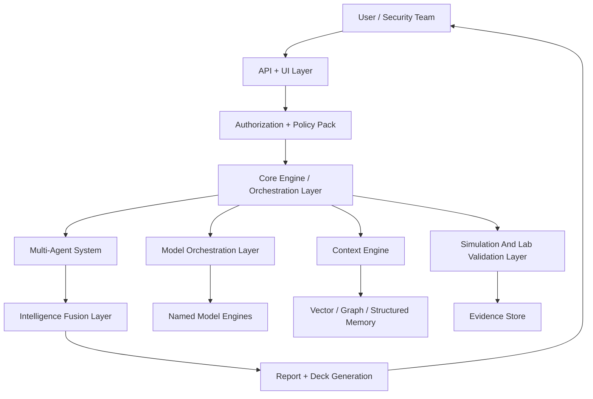
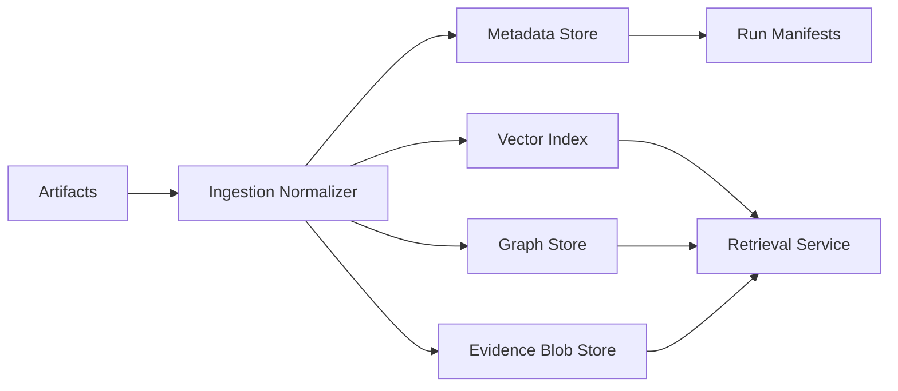
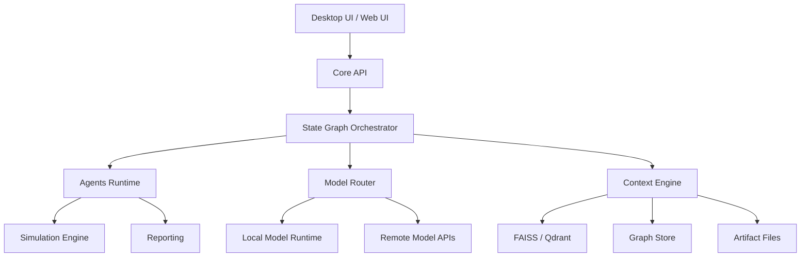
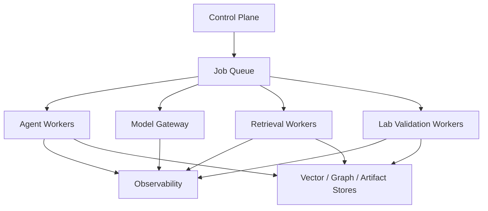

# System Architecture

## 1. Architecture principles

- `single-machine first`
- `policy before autonomy`
- `evidence before answer`
- `virtual long context instead of magical context claims`
- `named engines with explicit routing`
- `fusion over single-model dependence`
- `simulation over live offensive execution`

## 2. Logical layers

## 3. Core Engine

The `Core Engine` is the system brain. It owns:

- run lifecycle
- policy enforcement
- agent coordination
- routing requests
- checkpointing
- replay manifests
- observability

Recommended implementation:

- `FastAPI` service boundary
- `LangGraph` or equivalent explicit state graph
- typed contracts for all cross-layer traffic

## 4. Multi-Agent System

The `Multi-Agent System` is split into clear responsibilities:

- `Recon Agent`
- `Analysis Agent`
- `Simulation Agent`
- `Intelligence Fusion Agent`
- `Optimization Agent`
- optional `Policy Agent`, `Evidence Agent`, `Judge Agent`, `Report Agent`

This preserves the source emphasis on `Multi-Agent Systems`, `Orchestration`, `Parallel Processing`, and `Hybrid Intelligence`, but changes the runtime behavior from offensive automation into bounded validation and synthesis.

## 5. Model Orchestration Layer

The `Model Orchestration Layer` owns:

- engine registry
- task fingerprinting
- policy-aware routing
- parallel fan-out when a task benefits from consensus
- fallback logic
- latency and cost budgets

It supports named engines for:

- `Claude`
- `GPT`
- `Gemini`
- `DeepSeek`
- `Qwen`
- `Gemma`
- `Llama`
- `Mistral`
- `BitNet`
- local fallback engines

## 6. Context Engine

The source set repeatedly targets `100M Token`, `1M context`, `128K context`, and `200K context`. The practical design is:

- keep a small live working set
- virtualize the rest through memory tiers
- rebuild the exact task context pack on demand

### 6.1 Context tiers

| Tier | Contents | Candidate technology |
| --- | --- | --- |
| `Hot Context` | current task pack, short summaries, active citations | RAM |
| `Warm Context` | vector neighbors, graph neighbors, prior agent notes | `FAISS`, `Qdrant`, `ChromaDB`, `Redis` |
| `Cold Context` | full artifacts, logs, reports, code, diagrams | disk object store or filesystem |
| `Graph Context` | relationships across assets, findings, controls, repos | `Neo4j` or graph abstraction |

### 6.2 Core mechanisms

- `segmentation`
- `retrieval`
- `compression`
- `Graph RAG`
- structured evidence joins
- context-pack caching

### 6.3 Source-tech adaptation

| Source term | Architecture role |
| --- | --- |
| `GraphRAG` | graph retrieval and dependency traversal |
| `SSM`, `Mamba`, `Jamba` | long-sequence reasoning inspiration for local engine roadmap |
| `StreamingLLM` and `Attention Sinks` | heuristics for pruning cold context during local runs |
| `TurboQuant` | candidate cache and tensor transport optimization |
| `Hankel Matrix`, `Fractal`, `MAC Context Encoder` | research appendix, not assumed facts |

## 7. Intelligence Fusion Layer

The `Intelligence Fusion Layer` is where the platform becomes stronger than a single-model workflow.

It performs:

1. output normalization
2. citation extraction
3. contradiction detection
4. confidence calibration
5. evidence-weighted ranking
6. final answer synthesis

Fusion inputs can include:

- multiple frontier engines
- open-source engines
- local engines
- retrieval evidence
- simulation traces
- prior successful patterns

## 8. Simulation and Lab Validation Layer

This layer replaces the source project's unsafe live offensive behavior.

It supports:

- attack-graph simulation
- control-failure simulation
- blast-radius estimation
- lab-contained validation on mirrored assets or intentionally prepared targets
- replayable traces

It does not support:

- live offensive payload delivery
- stealth or evasion workflows
- persistence or propagation

## 9. Storage architecture

Recommended single-node defaults:

- metadata: `SQLite`
- vector index: `FAISS`
- graph: embedded graph or lightweight `Neo4j` deployment
- evidence blobs: filesystem

## 10. Single-machine deployment view

## 11. Distributed scale view

## 12. Technology choices

### Primary choices

- macro orchestration: `LangGraph`
- micro-team runtime: `CrewAI`-style node workers where useful
- structured contracts: `Pydantic`
- constrained generation: `Outlines` or `XGrammar`
- local retrieval: `FAISS`
- optional local acceleration: `OpenVINO`

### Preserved but optional or research-track

- `BitNet`
- `TurboQuant`
- `MoE`
- `MoD`
- `LoRA`
- `MCTS`
- `QuIP#`
- `GLA`
- `BTC-LLM`
- `Meta-Plasticity`
- `HDC`
- `SNN`

## 13. Architecture decisions from source contradictions

### Decision 1

The system cannot assume `bwrap` everywhere because the source set itself flags Windows and Linux mismatches.

Decision:

- define a sandbox abstraction
- use Linux `bwrap` where available
- use Windows-native isolation or `WSL2`/VM adapters where required

### Decision 2

The system does not claim literal always-resident `100M` context on commodity hardware.

Decision:

- implement `virtual large context`
- measure retrieval and compression quality
- benchmark task accuracy, not slogan-level token counts

### Decision 3

The system does not treat self-modifying offensive logic as a product feature.

Decision:

- keep optimization restricted to prompts, routing, caching, and safe evaluation policies
