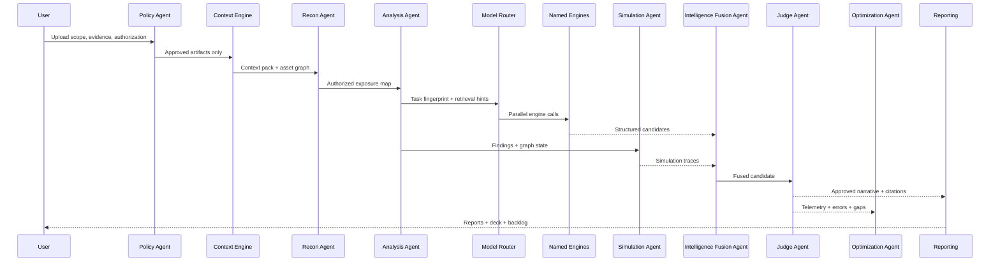
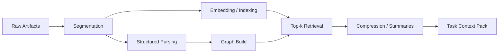

# Logical Flow

## End-to-end flow

1. User uploads authorization package, target scope, and artifacts.
2. `Policy Agent` validates scope and blocks unsupported requests.
3. Ingestion normalizer parses code, logs, configs, scanner results, prior reports, and architecture documents.
4. `Context Engine` segments artifacts and builds:
   - metadata index
   - vector index
   - graph relationships
   - replayable context packs
5. `Recon Agent` builds an authorized asset-and-exposure map from supplied evidence.
6. `Analysis Agent` correlates evidence against weakness, control, and dependency knowledge.
7. `Model Orchestration Layer` fingerprints the task and selects named engines.
8. One or more model engines run in parallel and return structured candidates.
9. `Simulation Agent` builds attack graphs and control-failure scenarios in simulation only.
10. `Intelligence Fusion Agent` merges model outputs, simulation traces, and evidence.
11. `Judge Agent` checks contradictions, missing citations, and policy violations.
12. `Optimization Agent` records telemetry and proposes future routing or retrieval improvements.
13. Reporting layer emits:
   - executive summary
   - technical report
   - remediation backlog
   - YC-style presentation narrative

## Sequence diagram

## Context handling flow

## Routing flow

1. classify task
2. apply policy constraints
3. determine required modalities
4. estimate context size
5. shortlist engines
6. decide single-engine versus ensemble
7. run structured prompts
8. normalize and score results

## Failure handling flow

- if scope invalid: stop
- if evidence incomplete: request more artifacts
- if model disagreement high: escalate to human review
- if retrieval confidence low: rebuild context pack
- if simulation output lacks evidence: suppress finding
