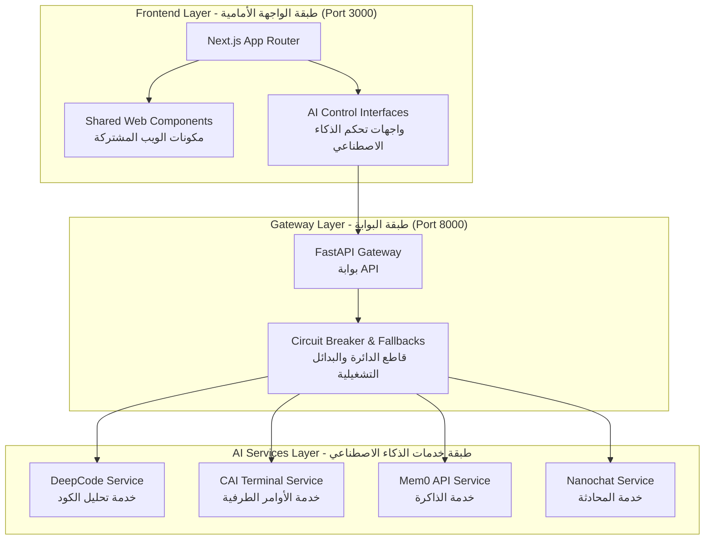

<!-- Original Path: C:\Users\Hossam Galal\Desktop\RED\ARCHITECTURE.md -->

# System Architecture - المرجعية المعمارية للنظام (Dragon-R1 Unified UI)

## Hybrid Architecture Approach | نهج المعمارية الهجينة

The Dragon-R1 Unified Console leverages a **Hybrid Architecture** that combines:
تعتمد لوحة التحكم الموحدة Dragon-R1 على **معمارية هجينة** تجمع بين:

1. **Direct Component Migration (النقل المباشر للمكونات)**: Next.js and Vite/React web interfaces are merged directly into the central `dragon-ui` Next.js App Router.
   *يتم دمج واجهات الويب المبنية بـ Next.js و Vite/React مباشرة داخل الموجه المركزي `dragon-ui` (Next.js App Router).*
   
2. **Microservices Integration (تكامل الخدمات المصغرة)**: Python-heavy AI logic (DeepCode, CAI, Nanochat, Mem0) are kept in their native runtimes (Streamlit, REST, Terminal apps) but interfaced through a FastAPI Gateway.
   *يتم الحفاظ على منطق الذكاء الاصطناعي الثقيل (المبني بـ Python مثل DeepCode, CAI, Nanochat, Mem0) في بيئات التشغيل الأصلية الخاصة بها (Streamlit, REST، تطبيقات الطرفية) مع ربطها عبر بوابة FastAPI (Gateway).*

---

## Logical Flow | التدفق المنطقي

---

## Resilience & API Principles | مبادئ المرونة وواجهات برمجة التطبيقات

- **Circuit Breaker (قاطع الدائرة)**: The Gateway manages fail-fast states if AI engines crash. 
  *تدير بوابة API (Gateway) حالات الفشل السريع إذا تعطلت محركات الذكاء الاصطناعي.*
  
- **WebSocket TUI Integration (تكامل الأوامر الطرفية)**: The `dragon-ui` interfaces communicate bidirectionally with CAI Terminal services using Socket.io to stream real-time command output.
  *تتواصل واجهات `dragon-ui` بشكل ثنائي الاتجاه مع خدمات الأوامر الطرفية (CAI Terminal) باستخدام Socket.io لبث مخرجات الأوامر في الوقت الفعلي.*
  
- **Component Adapters (مهايئات المكونات)**: For pure React apps like Pentagi and DeepCode `new_ui`, we utilize Component Adapters to translate React Router `Contexts` into Next.js App Router `Layouts`.
  *بالنسبة لتطبيقات React الخالصة مثل Pentagi و DeepCode `new_ui`، يتم استخدام مهايئات المكونات (Component Adapters) لترجمة `Contexts` الخاصة بـ React Router إلى `Layouts` الخاصة بـ Next.js App Router.*
