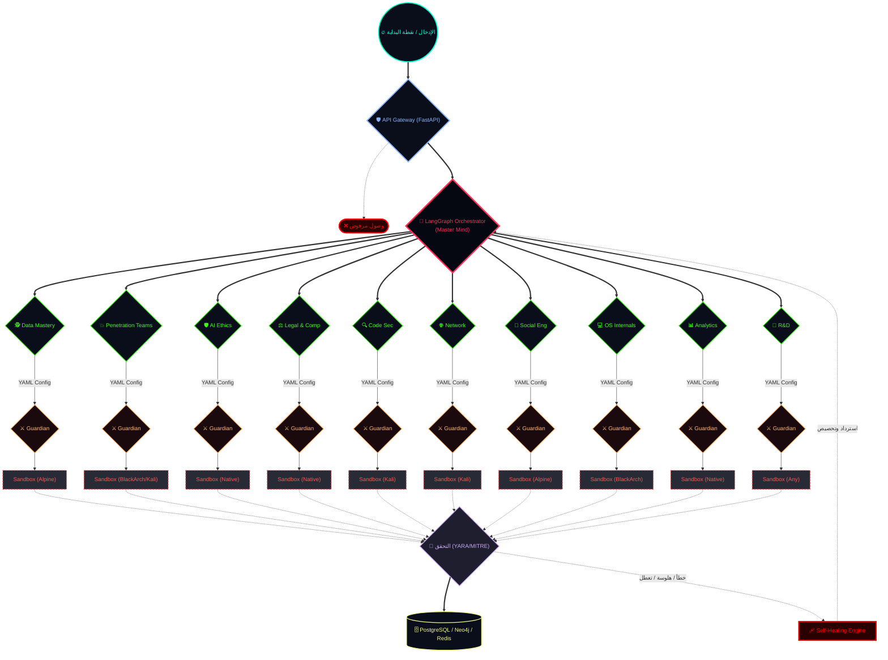

# **وثيقة التطوير والتحسين الشاملة – Dragon R1**

<div align="left" style="font-size: 12px; font-weight: bold; color: #4CAF50; border: 1px solid #4CAF50; padding: 4px 8px; border-radius: 4px; display: inline-block;">
  🟢 Project Maturity: 15% - [UI: Active, Core: Transitioning, Agents: Pending]
</div>

**الإصدار النهائي (مراجعة شاملة)**  
**التاريخ:** 2026-03-29  
**الجهة المستهدفة:** فريق التطوير / مساعد البرمجة (Codex)  
**الهدف:** توثيق كامل لكل متطلبات المشروع من النقاشات السابقة، مع ضمان الدقة والشمولية والاحترافية.

---

## **0. خريطة شرايين النظام (Data Flow & Architecture Map)**

المخطط التالي يوضح مسار البيانات، آليات تحميل الوكلاء، ومسارات "الاسترداد الذاتي" التي تضمن استمرار عمل المشروع تحت أي ظرف (حتى لو تعطل أحد شرايينه، يعبر من شريان بديل).



---

## **1. الرؤية العامة**

**Dragon R1** هو منصة اختبار اختراق ذكية، تعمل بالكامل عبر واجهة طرفية (CLI/TUI)، مصممة لتكون:
- **معيارية (Modular):** يمكن إضافة أو إزالة أي مكون دون التأثير على البنية الأساسية.
- **ذكية (Intelligent):** تستخدم LangGraph لإدارة سير العمل المعقد والتفرعات، وCrowd AI لتنسيق فرق من الوكلاء المتخصصين، ونماذج محلية مضغوطة (llama.cpp) للتحليل والابتكار.
- **خفيفة (Lightweight):** تعتمد على تقنيات ضغط متقدمة (SquashFS، OverlayFS، Nix، Lazy Pulling) لتقليل استهلاك الموارد مع الحفاظ على السرعة.
- **قابلة للتوسع (Scalable):** تدعم البنية الموزعة (Master‑Satellite) والتكامل مع السحابة والجدران النارية.
- **آمنة وأخلاقية (Secure & Ethical):** تفرض الامتثال القانوني، وتوثق كل إجراء، وتحتوي على مفتاح قتل مادي وطبقات حماية متعددة.

---

## **2. المعمارية الأساسية (Core Architecture)**

### **2.1 العزل والجدولة**
- **عزل مكونات R1:** يتم تشغيل كل وكيل أو أداة خطيرة في **Pod منفصل داخل Kubernetes (k3s)** مع **Sandboxing** باستخدام **Firecracker** أو **gVisor**.
- **الجدولة الذكية للمهام:** استخدام Kubernetes cron jobs لتشغيل المهام الثقيلة (مثل مسح شامل) خارج أوقات الذروة، مع إمكانية تفعيل **وضع استباقي** يقوم فقط بالمسح دون تنفيذ هجمات فعلية (لتوفير الموارد).

### **2.2 بنية موزعة (Master‑Satellite)**
- **Master Box:** الصندوق المركزي الذي يحتوي على جميع قواعد البيانات، نماذج الذكاء الاصطناعي، ولوحات التحكم.
- **Satellite Agents:** وكلاء خفيفون (Go/Rust) يتم توزيعهم على الفروع أو الأجهزة البعيدة، يجمعون البيانات ويرسلونها عبر **NATS** أو **gRPC** إلى Master.
- **الوكيل السحابي (Cloud Agent):** يتم نشره كـ Lambda Function أو Container في AWS/Azure/GCP، يجمع سجلات CloudTrail/Azure Monitor ويرسلها عبر نفق مشفر (VPN).

---

## **3. إدارة البيئات والتوزيعات (Environment Management)**

### **3.1 التوزيعات الأساسية الثلاث**
- **Black Arch:** للمهام المعقدة جداً (استغلال متقدم، هندسة عكسية، AD متقدم) – تخزين مضغوط بـ SquashFS بحجم 2-3 جيجابايت (بدلاً من 12).
- **Kali Linux:** للمهام متوسطة التعقيد (ويب، شبكات، ثغرات شائعة) – حجم 1-2 جيجابايت.
- **Alpine Linux + BusyBox:** للمهام البسيطة (مسح منفذ واحد، أوامر شبكية أساسية) – حجم 5-100 ميجابايت.

### **3.2 آلية الضغط والتحميل**
- **SquashFS + OverlayFS:** يتم تخزين كل توزيعة كصورة SquashFS مضغوطة بـ Zstd، وعند الحاجة تُحمَّل عبر OverlayFS مع طبقة كتابة مؤقتة.
- **Nix لإدارة الحزم الفردية:** عند تشغيل أداة واحدة (مثل `nmap`)، يتم استدعاؤها عبر `nix shell` مما يجلب فقط الأداة وتبعياتها بحجم ضئيل.
- **Lazy Pulling (Docker/OCI):** باستخدام eStargz أو overlaybd، يتم تحميل الطبقات الضرورية فقط عند الوصول إليها، مما يقلل وقت البدء.

### **3.3 الاختيار الذكي للتوزيعة**
- **Auto Mode:** يقوم الـ AI بتحليل المهمة (نوع الهدف، الأدوات المطلوبة، تعقيد الهجوم، قاعدة بيانات أفضل الممارسات) ويختار التوزيعة الأنسب.  
- **تجاوز المستخدم:** عبر `--distro` أو القائمة المنسدلة في الشريط العلوي.

---

## **4. طبقة الذكاء الاصطناعي (AI Layer)**

### **4.1 دمج LangGraph و Crowd AI**
- **LangGraph:** العقل المخطط – يدير سير العمل، التفرعات، حالة المشروع. يحدد المراحل (Recon → Scan → Exploit → Report) ويسند كل مرحلة لفريق من **Crowd AI**.
- **Crowd AI:** فرق تنفيذية من وكلاء متخصصين (مثلاً: Web Recon Team، AD Exploit Team). يتواصلون عبر بروتوكولات MCP/MQTT، ويشاركون الأفكار لتطوير سلوك جماعي مبتكر.

### **4.2 نظام التحقق من الهلوسة (Hallucination Prevention)**
- **Verification Layer:** طبقة مستقلة تعتمد على **قواعد حتمية** (Deterministic Rules) مثل MITRE ATT&CK، قواعد YARA، أو قاعدة بيانات ثابتة من التهديدات.  
- أي استنتاج من LLM يُعرض على هذه الطبقة؛ إذا تعارض مع القواعد، يُرفض الاستنتاج ويُظهر النظام تحذيرًا.

### **4.3 استخدام RAG بدلاً من Fine-tuning في البداية**
- يتم تغذية النموذج (مثل Hermes 2 Pro) بـ **سياق لحظي** من:
  - MITRE ATT&CK Framework
  - قواعد بيانات CVE
  - سجلات المهام السابقة المخزنة في Knowledge Base
  - بيانات جمعتها Data Mastery Team (بموافقة المستخدم)

### **4.4 التعلم المعزز بتغذية راجعة بشرية (RLHF) داخلياً**
- يقوم فريق Red Team البشري (أو المستخدم) بتقييم نتائج R1 (نجاح، فعالية، دقة).  
- تُستخدم هذه التقييمات لتحسين النماذج دورياً عبر fine-tuning.

---

## **5. منظومة الوكلاء والمهارات (Agents & Skills Ecosystem)**

### **5.1 التوسع عبر ملفات التكوين**
- كل وكيل (Agent) أو مهارة (Skill) أو بروتوكول (Protocol) يُعرَّف بملف YAML منفصل داخل المجلدات المخصصة (`/agents`, `/skills`, `/protocols`).
- عند بدء التشغيل، يقوم **Dragon Agent** بمسح هذه المجلدات، يتحقق من التبعيات، ويحمّلها ديناميكياً دون الحاجة لإعادة تشغيل النظام.
- **إمكانية إضافة وكلاء مؤقتين (Ephemeral Agents):** يمكن للمستخدم أو النظام استدعاء وكيل مؤقت لمهمة محددة، ثم يتم تفريغه بعد الانتهاء لتوفير الموارد.

### **5.2 الفرق المطلوبة (قائمة شاملة)**
تم الاتفاق على إنشاء الفرق التالية (مع إمكانية إضافة المزيد عبر R&D Team):

| الفريق | الوكلاء الفرعيون |
|--------|------------------|
| **Data Mastery Team** | Web Crawler, Data Cleaner, Data Labeler |
| **Crowd AI Teams** | Web Recon, AD Exploit, Cloud Security, Wireless/IoT, Privilege Escalation, Payload Optimization |
| **Code Security Team** | Static Analysis, Dynamic Analysis, Dependency Scanner, Code Quality |
| **Social Engineering Team** | Phishing Campaign, Pretexting, OSINT |
| **OS Internals Team** | Windows Internals, Linux Kernel, macOS/iOS, Android |
| **Advanced Network Team** | Protocol Fuzzer, Packet Analysis, Wireless Exploitation |
| **AI Ethics & Red Teaming** | AI Behavior Auditor, Adversarial AI, Compliance Checker |
| **Advanced Data Analytics Team** | Pattern Recognition, Predictive Analytics, Attack Graph Generator, Correlation |
| **R&D Team** | Performance Auditor, Tool Integration, Self-Refactor, Version Control, New Specialization Scout |
| **Legal & Compliance Team** | Jurisdiction Analyzer, Consent & Authorization, Risk Assessor, Incident Reporter |

### **5.3 إنشاء مهارات ديناميكية (On‑Demand Skills)**
- يمكن للـ Dragon Agent أو المستخدم كتابة مهارة جديدة (مثل `bypass_waf_skill`) في ملف YAML يحدد:
  - الأدوات المطلوبة
  - البيئة المفضلة
  - خطوات التنفيذ (مباشرة أو عبر استدعاء وكلاء)
  - الشروط المسبقة
- النظام يقوم بتحميل المهارة فوراً ويجعلها متاحة في الشريط الجانبي أو عبر الأوامر.

### **5.4 استدعاء وكيل غير موجود**
- إذا طلب النظام مهمة تتطلب وكيلاً غير مثبت، يقوم **R&D Team** (أو المستخدم) بالبحث عن وكيل جاهز (من مستودع مفتوح المصدر) أو إنشاء ملف YAML جديد له، ثم تحميله دون توقف.

---

## **6. نظام التقارير والتواصل الهرمي (Reporting & Communication)**

### **6.1 نموذج التقرير الموحد (JSON)**
كل فريق يرسل تقريراً دورياً يحتوي على:
```json
{
  "report_id": "uuid",
  "team": "DataMasteryTeam",
  "timestamp": "...",
  "achievements": ["..."],
  "challenges": ["..."],
  "recommendations": ["..."]
}
```

### **6.2 قاعدة البيانات المركزية**
- **PostgreSQL:** للمهام، تعريفات الوكلاء، التقارير المنظمة.
- **Elasticsearch:** للبحث السريع في البيانات غير المنظمة (سجلات الشبكة، مخرجات الأدوات).
- **SurrealDB / Neo4j:** للرسوم البيانية (Graph) التي تربط الأحداث، الأهداف، المستخدمين.

### **6.3 التواصل الهرمي**
- **Dragon Agent** هو القائد، يتلقى التقارير الموجزة عبر API.
- الفرق ترسل التقارير دورياً (كل 6 ساعات افتراضياً) وتتلقى ردوداً/توجيهات.
- لا ينغمس Dragon Agent في التفاصيل التشغيلية (مثل كيفية جمع البيانات).

---

## **7. وضع الأتمتة الكاملة (Dragon Mode)**

### **7.1 خصائص Dragon Mode**
- **استقلالية تامة:** يحدد المهمة، يخطط لها، ينفذها، ويتحقق من النتائج دون أي تدخل بشري.
- **الاستشفاء الذاتي (Self‑Healing):** إذا فشلت مهمة (مثل أداة تتعطل، بيئة تالفة)، يقوم النظام بتحليل الخطأ، البحث عن بديل (أداة أخرى، بيئة أخرى)، ويعيد المحاولة.
- **التبديل الذكي بين البيئات:** يتحرك بين WSL، Docker، Native حسب متطلبات الأداة ومدى توفرها.
- **التعلم المستمر:** يسجل كل نجاح وفشل، ويستخدمها لتحسين الخطط المستقبلية.

### **7.2 متطلبات تحقيق Dragon Mode**
- **محرك تنفيذ حتمي (Guardian) بلغة Rust/Go:** LLM لا ينفذ مباشرة، بل يختار **Token** يمثل وظيفة محددة مسبقاً (مثل `run_nmap`، `generate_payload`). محرك Rust/Go ينفذ الوظيفة بعد التحقق من الصلاحيات.
- **قاعدة معرفة ديناميكية (Knowledge Base):** تخزين كل ما تعلمه النظام من هجمات سابقة، أنماط نجاح، أخطاء شائعة.
- **طبقة أمان متعددة:** مفتاح قتل مادي، MFA للعمليات الحرجة، توثيق كل خطوة (Chain of Custody).

---

## **8. استراتيجيات التحسين الذاتي والاستشفاء الذاتي**

### **8.1 التحسين الذاتي (Self‑Improvement)**
- **دورة التعلم الذاتي:**  
  1. **جمع البيانات:** Data Mastery Team يجلب بيانات جديدة من مصادر خارجية وداخلية.  
  2. **تحليل الأنماط:** Advanced Data Analytics Team يستخرج أنماطاً وتنبؤات.  
  3. **Fine‑tuning:** ML Training Specialist Agent يقوم بتحديث النموذج المحلي (llama.cpp) باستخدام البيانات المصنفة.  
  4. **اختبار التحسينات:** Continuous Testing Agent يختبر النموذج الجديد في بيئة محاكاة.  
  5. **التحديث التلقائي:** إذا تحسن الأداء، يتم استبدال النموذج الأساسي.
- **دور R&D Team:** متابعة أحدث التقنيات، اقتراح دمج أدوات جديدة، إضافة تخصصات جديدة للمنظومة.

### **8.2 الاستشفاء الذاتي (Self‑Healing)**
- **مراقبة مستمرة (Health Monitor):** يتأكد من سلامة الصور (SquashFS)، صلاحية الاتصال بالشبكة، توفر الأدوات.
- **الإصلاح التلقائي:** عند حدوث خطأ:
  - يقرأ النظام رسالة الخطأ.
  - يحللها عبر LLM (مع سياق).
  - ينفذ إجراءات مثل: إعادة تثبيت حزمة تالفة، تبديل التوزيعة، إعادة ضبط OverlayFS، استدعاء وكيل بديل.
- **التعلم من الأخطاء:** يتم تخزين الأخطاء والحلول المرتبطة بها في قاعدة البيانات ليصبح النظام أسرع في حل المشكلات المتكررة.

---

## **9. ضمان الجودة (Smoothness, Efficiency, Accuracy, Stability)**

### **9.1 السلاسة (Smoothness)**
- **واجهة TUI سريعة الاستجابة:** استخدام مكتبات مثل `bubbletea` (Go) أو `rich` (Python) مع تحديثات مباشرة (live updates) دون تأخير.
- **إكمال تلقائي (Autocomplete) واقتراحات ذكية (Ghost Text):** تسريع كتابة الأوامر.
- **دعم العمل عبر SSH:** كل الوظائف متاحة عن بُعد.

### **9.2 الكفاءة (Efficiency)**
- **تحميل عند الطلب (Lazy Loading):** لا يتم تحميل أي بيئة أو أداة إلا عند الحاجة.
- **ضغط متقدم (Zstd, SquashFS, Parquet):** تقليل استهلاك القرص والذاكرة.
- **جدولة المهام الثقيلة خارج أوقات الذروة:** باستخدام Kubernetes cron jobs.

### **9.3 الدقة (Accuracy)**
- **طبقة التحقق من الهلوسة:** منع الاستنتاجات الخاطئة.
- **قواعد حتمية (Deterministic Rules):** ضمان تنفيذ الإجراءات المعروفة بشكل صحيح.
- **اختبار آلي (Test Suite):** تشغيل آلاف السيناريوهات بعد كل تحديث.

### **9.4 الاستقرار (Stability)**
- **عزل المكونات (Kubernetes + Sandboxing):** فشل أحد المكونات لا يؤثر على الآخرين.
- **استخدام توزيعات أساسية ثابتة (Debian Stable / Alpine):** مع تحديث طبقة الأدوات فقط.
- **تحديثات موقعة رقمياً:** منع دفع تحديثات ضارة أو غير مستقرة.

---

## **10. مواصفات إضافية لتحسين الأداء (Resource Optimization)**

- **حدود استهلاك الموارد:** كل وكيل له حد أقصى من CPU/RAM قابل للتكوين؛ عند تجاوزه، يتم إيقافه مؤقتاً.
- **إدارة مساحة التخزين:** حذف الصور المؤقتة (overlay) بعد الجلسة، وتنظيف التوزيعات غير المستخدمة تلقائياً.
- **تقنيات الضغط الإضافية:**  
  - **Quantization للنماذج:** استخدام GGUF (4‑bit, 8‑bit) لتقليل حجم النماذج المحلية.  
  - **Parquet للبيانات المجدولة:** ضغط أعلى وسرعة قراءة أفضل.  
  - **Zstd للصور SquashFS:** توازن ممتاز بين الضغط والسرعة.

---

## **11. معايير القبول النهائية (Final Acceptance Criteria)**

1. **الواجهة:**  
   - عنصر `Tasks` في الشريط الجانبي مع صفحة كاملة.  
   - `Distribution Selector` في الشريط العلوي مع خيارات Auto, Kali, BlackArch, Alpine.  
   - أوامر إضافية: `pensec tasks`, `pensec config set distro`, `pensec analytics report`, `pensec rd report`, `pensec legal status`.

2. **الذكاء:**  
   - LangGraph و Crowd AI يعملان معاً، ويستطيعان تنفيذ سيناريو كامل (Recon → Exploit → Report) مع طبقة تحقق من الهلوسة.

3. **الوكلاء:**  
   - جميع الفرق المذكورة (10 فرق) منشأة كملفات YAML قابلة للتحميل الديناميكي.  
   - يمكن استدعاء وكيل غير موجود في وقت التشغيل (إنشاء مؤقت أو دائم).

4. **التعلم الذاتي:**  
   - يتم تنفيذ دورة fine-tuning كاملة (جمع بيانات → تدريب → اختبار → تحديث) بشكل تلقائي أو شبه تلقائي.

5. **الاستشفاء الذاتي:**  
   - النظام يستطيع اكتشاف فشل أداة/بيئة، واتخاذ إجراء تصحيحي (تبديل البيئة، إعادة المحاولة) دون تدخل المستخدم.

6. **الأمان والامتثال:**  
   - `Legal & Compliance Team` يمنع تنفيذ أوامر خارج النطاق المسموح به مع MFA للعمليات الحرجة.  
   - كل إجراء موثق رقمياً (Chain of Custody).  
   - مفتاح قتل مادي (أو واجهة Emergency Stop) يعمل.

7. **الأداء:**  
   - لا تتجاوز زيادة استخدام الذاكرة 30% عن الإصدار الأساسي.  
   - وقت التبديل بين التوزيعات < 5 ثوانٍ.  
   - فتح صفحة `Tasks` < 2 ثانية.

---

## **12. خارطة الطريق الزمنية (Roadmap)**

| المرحلة | المدة | المخرجات الرئيسية |
|---------|-------|-------------------|
| **المرحلة 1 (MVP)** | 3 أشهر | UI الأساسية (Tasks, Distro Selector)، LangGraph + Crowd AI الأساسي، eBPF/Tetragon للرصد، Graph DB، Guardian بلغة Rust، ميدان اختبار داخلي، واجهة دردشة بالعربية (RAG). |
| **المرحلة 2 (توسيع)** | 4 أشهر | جميع الفرق المتخصصة (10 فرق)، دعم Windows (ETW)، Vector DB + Graph DB، التكامل مع pfSense/Fortinet، RBAC وواجهات متعددة، نظام التحقق من الهلوسة. |
| **المرحلة 3 (نضج)** | 3 أشهر | البنية الموزعة (Master‑Satellite)، الوكيل السحابي، محرك القواعد البصرية، تحديثات موقعة، اختبارات آلية شاملة. |

---

## **13. خاتمة**

هذه الوثيقة تجمع **جميع التفاصيل التقنية، المعمارية، والوظيفية** التي تم الاتفاق عليها من خلال النقاشات المتعمقة مع فريق الخبراء والمستخدمين، مع التركيز فقط على **Dragon R1** (الجانب الهجومي).

**تم إعداد هذه الوثيقة كمرجع نهائي للتطوير والتحسين لمشروع Dragon R1.**  
**يُرجى اعتمادها والبدء في المرحلة الأولى.**
